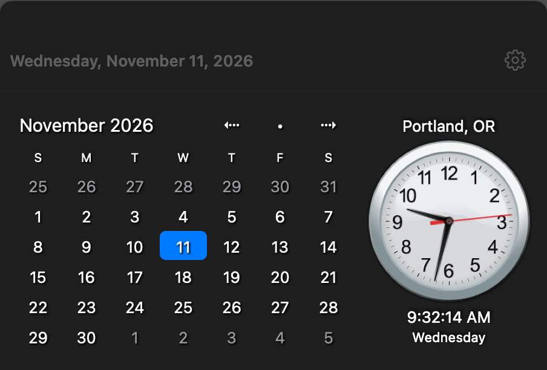

# VistaClock 

**VistaClock** is a quick and easy way to show a calendar and analog clock with second hand. It's the missing Windows task clock for MacOS.

Rather than loading a time consuming calendar to simply get the date for next Tuesday, Vista Clock is just a click away.

**Features**:

- Quick access to calendar and analog clock with second hand.
- Start on Login option.
- Week Number Icon in the statusbar (color or monochrome).
- Auto hide when not in focus.
- Keep on Top option.
- Any number of extra clocks with time zone support, edited in place and reordered by dragging.
- Format statusbar clock: date and time, fuzzy time ("Quarter past Three"), a secondary time zone, or inverse colors (black on white).
- Custom Clock Control, choice of clock faces.
- Custom Calendar Control.
- Week Number calendar view.
- Automatically hides when not in focus.
- Connects to iCal and Reminders and shows indicators.

## Screenshots

## Versions

> [2.3.4](builds/VistaClock_v2.3.4/VistaClock.zip)
>
> Changes:
>
> - Works with Intel and Silicon chip sets

> [2.4.0](builds/VistaClock_v2.4.0/VistaClock.zip)
>
> Changes:
>
> - Open sourced code
> - Update to support latest MacOS
> - Updated for Silicon only
>
> Issues:
>
> - Untested

> [3.0.0](builds/VistaClock_v3.0.0/VistaClock.zip)
>
> Changes:
>
> - Convert to Swift
> - Update the UI
> - Tested with MacOS Version 26+

> [3.0.1](builds/VistaClock_v3.0.1/VistaClock.zip)
>
> Changes:
>
> - Use Inverse Color now works (black text on a white background in the menu bar)
> - The clock list on the Clock preferences tab edits in place: name, time zone and seconds
> - Drag clocks to reorder them
> - The build number is the short git hash
> - Updated help
> - Added unit tests

## Install

Unzip `VistaClock.zip` from the [builds](builds) folder and move **VistaClock.app** to Applications. VistaClock requires **MacOS 26 or later** and the released builds are for Apple silicon.

The builds are signed to run locally and are not notarized, so on first launch MacOS may ask you to allow the app in **System Settings > Privacy & Security**. VistaClock asks for Calendar and Reminders access to show the event and reminder indicators.

## Building

Open `VistaClock.xcodeproj` in Xcode and build the **VistaClock** scheme. No developer account is needed: the project signs to run locally.

The build number is set to the short git hash of the checkout you build from (a build outside a git checkout keeps the number in the project settings).

## Tests

The unit tests use Swift Testing. Run them from Xcode with Product > Test (⌘U).

## Support

**Bugs and requests?** Please use the project's [issue tracker].

**Want to contribute?** Please fork this repository and open a pull request with your new changes.

**Do you like it?** Support the project by starring the repository or [tweet] about it.

## Thanks for looking!

_If you like what you see_ 

**VistaClock** © 2026, Mazookie, LLC. Released under the [MIT License](LICENSE).

[tweet]: https://twitter.com/intent/tweet?
[issue tracker]: https://github.com/pawong/VistaClock/issues/new

Q: What is Mazookie?

A: Mazookie is a company that used to put apps on the MacOS App Store. This doesn't happen any more because Apple charges money to be a developer and there's no money in these apps, so the projects have been opensourced. Yeah, free stuff!
